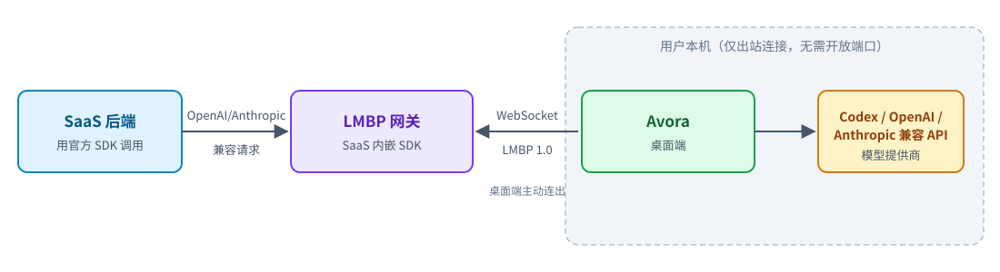

# 一线牵（Avora）

一线牵（英文名 Avora）是 macOS / Windows 桌面应用：让你授权的远端服务（SaaS）调用你本机的模型——已登录的 Codex 订阅，本地运行的 Ollama 模型，或你配置的 OpenAI / Anthropic 兼容 API。密钥和模型都留在本机，SaaS 只能用你允许的模型。

## 工作原理

桌面端主动连出到网关，本机无需开放端口。设备与网关之间使用开放协议 **LMBP 2.0**（正式版），见 [规范](docs/lmbp-spec.md)。2.0 不兼容 1.x：网关（含 SDK 实现）与桌面端必须一起升级，见 [发布说明](docs/release.md#lmbp-20-升级)。

## 快速上手

1. **安装**：从 [Releases](https://github.com/tyro668/avora/releases) 下载安装包（macOS `.dmg`，Windows `setup.exe`）。安装包暂未签名，首次打开的处理方法见 [docs/release.md](docs/release.md#未签名构建的注意事项)。
2. **添加方案**：点「添加方案」，选择「OpenAI Codex（订阅）」「OpenAI 兼容协议」「Anthropic 兼容协议」或「Ollama 协议（本地模型）」，填好后点「测试连接」再「保存」。

   

3. **连接 SaaS**：点状态栏的「立即连接 ›」，粘贴 SaaS 的地址或 `lmbp://pair?…` 链接。确认 SaaS 身份并勾选允许它使用的模型，再把显示的配对码填到 SaaS 页面上。

   

4. **查看连接**：点状态栏左侧的状态标签。每个 SaaS 有自己的模型授权，可以随时断开或撤销；断线会自动重连。

   

> 从 LocalSubProxy 升级：本应用原名 LocalSubProxy。安装新版后首次启动会自动把已有的连接和配置迁移到新的数据目录，不需要重新配对。macOS 上迁移完成后请删除旧的 `LocalSubProxy.app`，详见 [CHANGELOG.md](CHANGELOG.md)。

完整图文教程（方案管理、状态说明、用量统计、常见错误等）见 **[docs/guide.md](docs/guide.md)**。

- 关闭窗口只隐藏界面，内核在后台运行；从系统托盘「配置」重新打开，「退出」停止。
- 每次请求写入本机审计日志 `audit.db`（不记录对话内容，默认保留 90 天），可在「用量统计」或命令行 `avora usage`、`avora audit` 查看。
- Codex 方案只接受纯文本，不支持 `temperature`、`top_p`、`stop`、`max_tokens`，见规范 §16.4。

## SaaS 开发者：选一个 SDK

| 语言 | SDK | 示例 |
|---|---|---|
| Go（参考实现） | [sdk/go](sdk/go/README.md) | [examples/go-nethttp](examples/go-nethttp) |
| Node.js | [sdk/node](sdk/node/README.md) | [examples/express](examples/express) |
| Python（ASGI） | [sdk/python](sdk/python/README.md) | [examples/fastapi](examples/fastapi) |
| Java（Spring Boot） | [sdk/java](sdk/java/README.md) | [examples/spring-boot-demo](examples/spring-boot-demo/README.md) |

SDK 负责配对和协议，你的业务代码用官方 `openai` / `anthropic` 客户端调用即可。各实现的差异见 [docs/implementations.md](docs/implementations.md)。本机联调（假模型 + 网关 + 聊天页）：`scripts/mock-start.sh [go|node|python|java|rust]`，详见 [mock/README.md](mock/README.md)。

## 文档

完整索引见 [docs/README.md](docs/README.md)。服务器或无桌面环境请用命令行的无界面模式：[docs/headless.md](docs/headless.md)。

## 从源码构建与测试

- 构建：macOS `./scripts/build-macos.sh`，Windows `.\scripts\build-windows.ps1`（需要 Go ≥ 1.24.6、Flutter）。发布流程见 [docs/release.md](docs/release.md)。
- 全量校验：`scripts/verify-all.sh`（14 步，覆盖各语言 SDK、mock、规范校验、互通测试和聊天页 E2E，任何跳过都判失败）。
