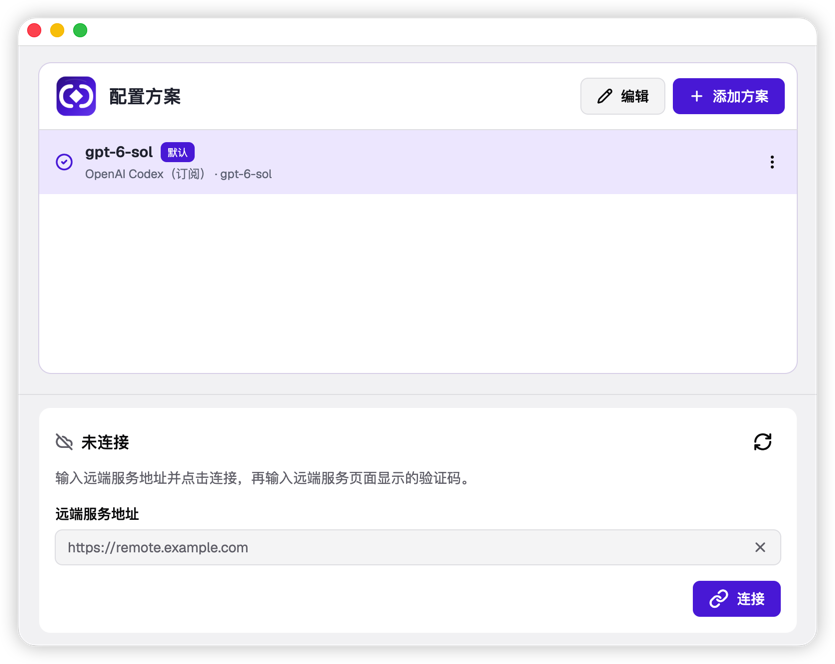
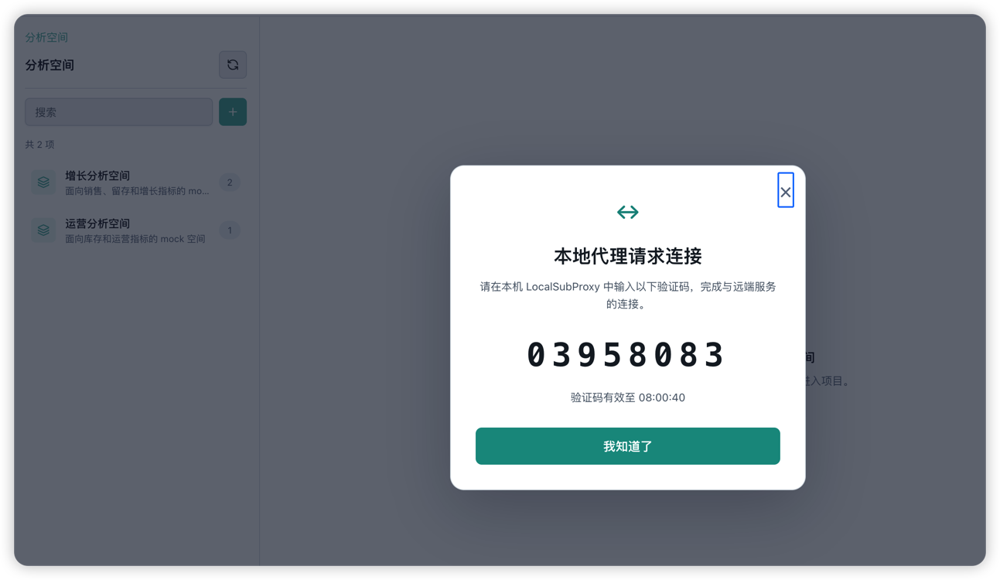
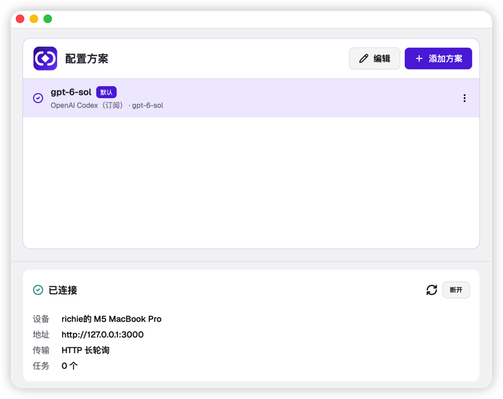

# LocalSubProxy

LocalSubProxy 是一个 macOS / Windows 桌面应用，让远端服务使用本机已登录的 Codex 订阅，或使用你配置的 OpenAI、Anthropic 兼容 API。打开应用时，配置界面和本地内核会一起启动；添加模型方案无需先连接远端服务。

## 使用流程

1. 打开应用，在底部的「远端服务地址」输入服务地址，点击「连接」。按联调说明启动参考网关和模拟服务后，本机可填写 `http://127.0.0.1:3000`；远端地址使用 HTTPS。
2. 应用显示一个 `XXXX-XXXX` 配对码和确认链接。
3. 在已登录的远端服务页面输入配对码并确认，应用会自动完成连接。界面会显示本机设备名称、服务地址和连接状态；设备私钥加密保存在本机。远端服务或网关停止时会显示「未连接」，服务恢复后自动重连，无需重新配对。
4. 点击「添加方案」配置模型。你也可以先添加方案，再连接远端服务。

## 配置模型方案

点击「添加方案」，填写方案名称并选择「API 提供商」。目前可以新建三种方案：

| 提供商 | 需要填写或操作 |
| --- | --- |
| OpenAI Codex（订阅） | 使用本机官方 Codex CLI 的 ChatGPT 登录态；如未登录，点击「连接订阅」并在浏览器完成登录，然后选择模型。 |
| OpenAI 兼容协议 | 填写 API 地址、API 密钥和供应商提供的模型 ID。 |
| Anthropic 兼容协议 | 填写 API 地址、API 密钥和供应商提供的模型 ID。 |

「上下文窗口」和「最大输出 Token」可留空使用自动检测。若提供商不支持模型列表接口，开启「模型列表探测」旁的开关以跳过探测。填写完成后可点击「测试连接」检查可用性，再点击「确定」保存。

方案列表中可以编辑、重命名、设为默认方案或删除方案。断开远端服务连接时，本机模型方案会保留。

## 窗口与退出

点击窗口关闭按钮只会隐藏配置界面，内核继续在后台运行；macOS 的 Dock 图标也会隐藏。通过系统托盘菜单的「配置」重新打开窗口，或选择「退出」停止应用。

## 从源码构建

macOS 运行 `./scripts/build-macos.sh`，Windows 运行 `.\scripts\build-windows.ps1`。构建环境与联调见 [实现与集成设计](design/实现与集成设计.md)；服务端接口见 [远端服务接入协议](design/远端服务接入协议.md)；原始架构方案见 [详细设计方案](design/SaaS本地大模型连接器详细设计方案.html)。

## 协议 lsp2 与其他语言实现

设备与网关之间使用开放协议 **lsp2**。它完全基于公开标准：
- RFC 8628 设备配对；
- 用 Ed25519/EdDSA 签名的 JWS/JWT，令牌与设备密钥绑定（`cnf.jkt`）；
- WebSocket 子协议 `lsp2`；
- OpenAI 兼容接口，支持 SSE 流式输出。

任何语言（Java、Node.js、Python、Go、Rust……）都可以实现网关或租户后端：

| 资料 | 位置 |
|---|---|
| 规范（RFC 风格） | [docs/protocol-v2.md](docs/protocol-v2.md) |
| 实现指南（各语言推荐库、陷阱、代码骨架） | [docs/implementers-guide.md](docs/implementers-guide.md) |
| JSON Schema / OpenAPI 3.1 / AsyncAPI 3.0 | [spec/](spec) |
| 测试向量 | [spec/testvectors/vectors.json](spec/testvectors/vectors.json) |
| Python / Node.js / Rust 骨架（已用测试向量验证） | [spec/examples/](spec/examples) |
| 黑盒一致性测试 | `LSP2_TENANT_KEY=... go run ./cmd/lsp2-conformance -gateway <url> -tenant <id>` |
| 一键校验 | `spec/validate.sh` |

Go 参考实现位于 `internal/lsp2`，网关用 `localsubproxy server` 启动。业务服务的模拟实现与端到端演示见 [mock/README.md](mock/README.md)（`go run ./mock/cmd/lspmock demo`）。
