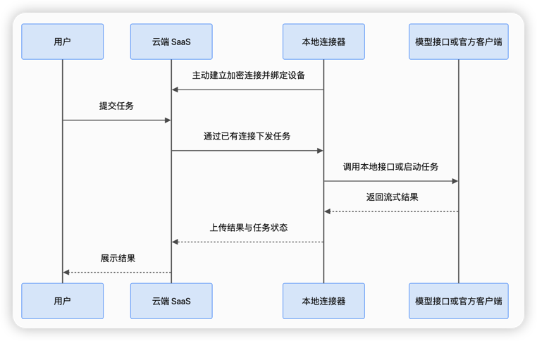

# 实现与集成设计

> **注意**：本文描述的是旧版 `connector.v1`，现已改为需显式开启的兼容模式。默认协议是 v2，见 [docs/protocol-v2.md](../docs/protocol-v2.md)。

本文记录当前实现的本地内核、参考网关、协议、命令行联调和运行边界。桌面应用的日常操作请参阅 [README](../README.md)；原始方案见 [详细设计方案](SaaS本地大模型连接器详细设计方案.html)。

## 组件与调用流程

- `server`：供远端服务调用的参考网关，提供任务 API、调度和连接器长轮询接入。远端服务通过任务 API 提交请求并订阅结果。
- `connector`：用户设备上的常驻出站连接器。新方案提供 OpenAI Codex 订阅、OpenAI 兼容协议和 Anthropic 兼容协议三种供应商；已有 Ollama 配置仍可读取。
- `desktop`：macOS / Windows 桌面界面。通过 Dart FFI 调用进程内 Go 共享库，管理内核和适配器；UI 与内核之间不开放 HTTP 端口。

代码使用 Go 1.22+、Flutter 和 `github.com/gorilla/websocket`。当前网关仍是**单租户、单设备的参考实现**，但一个设备可同时发布多个适配器。生产部署还需接入现有远端服务登录、租户权限与正式设备凭据系统。



## 桌面应用与本地内核

### 本地调用与配置保存

桌面界面在自身进程加载 Go 共享库 `liblocalsubproxy.dylib`（macOS）或 `localsubproxy.dll`（Windows）。`LSP_Start`、`LSP_Call`、`LSP_Free` 是内核的本地 C ABI；Flutter 的 `NativeApi` 封装这些调用。UI 不启动本机 HTTP 管理服务。Go 内核通过 HTTP(S) 长轮询主动连接远端服务网关。

打开桌面应用时，UI 与 Go 内核一同启动。本机模型配置始终可用，无需先连接远端服务。首次连接时输入远端服务地址并点击“连接”；模拟远端服务页面会自动弹出 8 位验证码，再返回桌面应用输入验证码完成认领。连接信息在本机保存，下次打开自动恢复。界面显示本机主机名；协议使用的设备 ID 独立保存。连接器使用系统用户配置目录下的 `localsubproxy/journal.enc`、`localsubproxy/adapters.enc` 和权限为 0600 的 `localsubproxy/identity.json`；后者保存自动生成的本机加密密钥与认领得到的设备凭据。适配器配置和第三方 API Key 由 Go 用 AES-GCM 加密保存，列表只返回 `has_api_key`。请备份整个配置目录；丢失 `identity.json` 后需要用旧加密密钥迁移已有适配器与 journal。旧版配置首次启动时也会出现一次性迁移输入框。界面可新增、编辑和删除适配器，显示其健康与登录状态；编辑 Codex 方案时会读取本机官方 Codex CLI 的登录态和模型列表。运行中任务所用的适配器不可编辑或删除。

### 图标、托盘与构建

桌面标识的源文件是 `desktop/assets/brand/localsubproxy.svg`。安装 `rsvg-convert` 与 Pillow 后运行 `python3 scripts/generate-icons.py`，可重新生成 macOS 应用图标、菜单栏模板图、Windows 应用图标和界面标识。Windows 托盘直接复用程序图标资源；macOS 菜单栏使用同一图形的单色模板，自动适配深浅色。

点击桌面窗口关闭按钮会隐藏配置界面；macOS 上同时隐藏 Dock 图标，连接器继续在后台运行。通过系统托盘的“配置”菜单恢复窗口与 Dock 图标，通过“退出”菜单停止内核并退出应用。

macOS 构建（最低部署目标 12.0）：

```bash
./scripts/build-macos.sh
```

Windows 上构建（Flutter Windows 工具链与可供 Go cgo 使用的 GCC）：

```powershell
.\scripts\build-windows.ps1
```

macOS 脚本生成 Apple silicon / Intel 通用应用，Windows 脚本在 Windows 上生成 x64 应用；两个脚本都将 Go 共享库放进 Flutter 应用目录，并附带 `localsubproxy-cli` 命令行工具。开发时也可设置 `LSP_NATIVE_LIB` 指向已构建的共享库。命令行 `connector` 是独立的无界面运行方式；不要用相同设备身份和 journal 同时启动命令行与桌面内核。

### 模型供应商与接口

新建方案的供应商只有 `codex_app_server`、`openai_compatible` 和 `anthropic_compatible`。后两者均须填写 API 地址、API 密钥和模型 ID。地址可为 `https://host`、`https://host/v1` 或 `https://host/api/v1`；已有 `/v1` 后缀时不会重复追加。仅回环 IP 允许明文 HTTP。OpenAI 兼容协议调用 `/v1/models` 和 `/v1/chat/completions`，支持文本消息、JSON 响应和 Chat Completions SSE 正文增量。Anthropic 兼容协议调用 `/v1/models` 和 `/v1/messages`，使用 `x-api-key` 与 `anthropic-version` 请求头，支持文本消息、JSON 响应和 Messages SSE 文本增量。远端服务侧仍使用统一的 OpenAI 兼容文本接口；工具调用、图片和音频等扩展字段尚未传递。若提供方不支持模型列表，可开启界面中的“模型列表探测”开关以跳过探测，按本机配置的模型白名单开放任务。旧版 Ollama 配置仍可编辑和使用，但不能在界面中新建。

## 命令行与参考网关联调

以下命令用于开发环境独立运行参考网关和无界面连接器。桌面应用的模型方案直接在 UI 中配置。

使用 Ollama 时先启动服务，并确认已下载模型：

```bash
ollama list
```

生成三份不同的随机密钥。`LOCALSUBPROXY_JOURNAL_KEY` 必须在连接器重启后保持一致，否则无法解密未确认事件。不要把这些值提交到仓库。

```bash
export LOCALSUBPROXY_REMOTE_TOKEN="$(openssl rand -hex 32)"
export LOCALSUBPROXY_DEVICE_TOKEN="$(openssl rand -hex 32)"
export LOCALSUBPROXY_JOURNAL_KEY="$(openssl rand -hex 32)"
```

先构建，再在两个终端运行。两个进程需要相同的 `LOCALSUBPROXY_DEVICE_TOKEN`。远端服务令牌只交给远端服务后端；journal key 只交给连接器。已有部署的 `LOCALSUBPROXY_SAAS_TOKEN` 仍可作为兼容环境变量读取，新配置使用 `LOCALSUBPROXY_REMOTE_TOKEN`。

```bash
go build -o bin/localsubproxy ./cmd/localsubproxy
bin/localsubproxy server -listen 127.0.0.1:8080 -data ./data/server.json -device-id dev_local
```

Ollama 连接器：

```bash
bin/localsubproxy connector \
  -server-url http://127.0.0.1:8080 \
  -device-id dev_local \
  -adapter-id ollama-local \
  -ollama-url http://127.0.0.1:11434 \
  -models llama3.2 \
  -journal ./data/journal.enc
```

把 `llama3.2` 替换为 `ollama list` 中的模型名。正式网络部署时，在 server 前提供 HTTPS 反向代理，connector 使用 `https://` 地址；程序仅允许回环 IP 使用明文 HTTP。默认 server 仅监听回环地址。

连接器通过 HTTP(S) 长轮询 `/v1/connector/commands` 接收任务，使用设备 Bearer token 调用心跳、任务接受、启动许可、取消和事件 ACK 接口。网络中断后按指数退避重连，凭本地 journal 补传未确认事件，由服务端校验重复事件内容。心跳周期 25 秒，任务轮询最长 25 秒；生产环境应由反向代理终止 TLS，并保留标准证书校验。服务端原有 WebSocket 接口保留兼容，但桌面连接器不再使用。

文本附件试点支持 UTF-8 `text/plain`，单文件最大 1 MiB、每任务最多 5 个。内联任务 JSON 上限 128 KiB，较长文本需改用附件。远端服务上传到 `POST /v1/task-artifacts`，将返回的 `artifact_id` 放进任务的 `input.artifact_refs`；网关在同一任务内锁定引用，连接器只可凭设备身份及当前 `task_id`、`attempt_id` 下载，并校验 SHA-256 后作为不可信文本交给模型。远端服务不能指定本机文件路径；二进制文件、转换器和结果产物上传尚未支持。附件和正文都经过远端服务。

执行前服务端发放最多 120 秒的运行租约，运行中每 30 秒前续期；断网超过租约时连接器停止运行时并上报 `UNKNOWN`，服务端进入 `RECONCILING` 等待对账。本地 journal 默认上限 64 MiB，给终态事件预留 128 KiB；云端确认后的输出分块与敏感输入从 journal 中清理。可用 `-journal-max-mib` 调整上限。

### 模拟远端服务认领

模拟远端服务位于相邻的 `sophorn-mock-server` 项目。它用现有用户 Bearer token 校验 `ai` 权限与设备所有者，再以仅服务端持有的 `LOCALSUBPROXY_REMOTE_TOKEN` 调用本服务。在模拟远端服务中设置 `LOCALSUBPROXY_URL=http://127.0.0.1:8080`、相同的 `LOCALSUBPROXY_REMOTE_TOKEN`、`LOCALSUBPROXY_DEVICE_ID=dev_local`。控制台“本地模型”页可提交和取消任务。模拟服务部署在其他机器时，`LOCALSUBPROXY_URL` 需改为模拟服务能够访问的参考网关地址。

联调桌面应用认领时，用 `-require-binding` 启动 Go server。打开桌面应用后输入模拟远端服务地址（本机联调可用 `http://127.0.0.1:3000`），点击“连接”。模拟远端服务会在已登录的“本地模型”页自动弹出 8 位验证码，把它填回桌面应用。验证码 5 分钟内有效，错误最多尝试 5 次，重新签发会使旧码失效；绑定结果和所有者写入网关快照。模拟远端服务从登录态读取用户 ID。绑定前网关拒绝设备连接与任务提交。

服务端终端：

```bash
bin/localsubproxy server -listen 127.0.0.1:8080 -data ./data/server.json -device-id dev_local -require-binding
```

独立命令行 `connector` 仍需要环境变量中的设备令牌与 journal key；原 `pairing` 命令保留供旧联调脚本使用。不启用 `-require-binding` 的旧联调方式仍使用 `LOCALSUBPROXY_OWNER_USER_ID`（默认 `user_demo-user`）作模拟远端服务的固定所有者。当前模拟环境采用网关预置设备令牌，验证码认领后交给桌面内核保存；尚未实现设计稿中的设备密钥证明、短期设备令牌与轮换。

### Codex 官方客户端试点

先按[官方认证文档](https://learn.chatgpt.com/docs/auth)在本机运行 `codex login`，选择 ChatGPT 登录。连接器只接受 App Server 报告的 ChatGPT 账户；API Key 登录不会被当作订阅账户使用。读取当前账户可见的模型 ID 不会发起推理：

```bash
bin/localsubproxy codex-models
```

从输出中选择一个模型，在**同一个 OS 用户账户**下运行连接器：

```bash
bin/localsubproxy connector \
  -server-url http://127.0.0.1:8080 \
  -device-id dev_local \
  -adapter-id codex-local \
  -adapter-type codex_app_server \
  -codex-bin "$(command -v codex)" \
  -models YOUR_CODEX_MODEL_ID \
  -journal ./data/journal.enc
```

远端服务请求的 `operation` 必须为 `agent.run`，目标 `adapter_id` 为 `codex-local`。例如：

```bash
curl -sS http://127.0.0.1:8080/v1/llm-tasks \
  -H "Authorization: Bearer $LOCALSUBPROXY_REMOTE_TOKEN" \
  -H 'Content-Type: application/json' \
  -H 'Idempotency-Key: codex-example-0001' \
  -d '{"target":{"device_id":"dev_local","adapter_id":"codex-local","model_id":"YOUR_CODEX_MODEL_ID"},"operation":"agent.run","input":{"messages":[{"role":"user","content":"用三句话总结这段文本。"}]},"options":{"queue_ttl_seconds":300,"max_runtime_seconds":600}}'
```

Codex 适配器使用[官方 App Server 的 stdio JSON-RPC](https://learn.chatgpt.com/docs/app-server)：每次任务启动独立进程与临时工作目录，核对 ChatGPT 登录和模型列表，创建临时线程，转发最终答案片段。远端服务的消息角色会作为带标签的文本输入，并不会转换成 Codex 的系统指令；工具、附件和会话续接尚未开放。它要求只读沙箱、禁止审批，并请求关闭 Shell、Apps、Hooks、MCP 等扩展；遇到工具动作事件会终止任务。取消时先请求 `turn/interrupt`；只有收到运行时的 `interrupted` 终态才确认 `CANCELLED`，否则保留 `UNKNOWN`。**这是试点适配器**：官方目前将 `codex app-server` 标为实验性，且当前 CLI 的只读沙箱不能证明所有用户级配置和插件均被完全隔离。请在受控终端验证版本与权限后使用，勿将其作为无监督、可处理敏感本机文件的生产执行器。任务文本会由 Codex 发送至 OpenAI，任务输入与结果仍经过远端服务。

## 远端服务调用

远端服务端保存 `LOCALSUBPROXY_REMOTE_TOKEN`，以 Bearer token 调用。每次逻辑提交生成新的 `Idempotency-Key`；网络重试沿用原键。不要把此 token 放入浏览器。

兼容 Chat Completions 的文本接口提供 `GET /v1/models` 与 `POST /v1/chat/completions`。`model` 格式为 `adapter_id/model_id`，`stream: true` 返回 OpenAI 风格的 SSE `choices[].delta.content` 与 `[DONE]`。模拟远端服务在拥有者和 `ai` 权限校验后，转发为 `/api/llm/v1/local/models` 与 `/api/llm/v1/local/chat/completions`。该接口只实现文本 `model`、`messages`、`stream` 子集，任务 API 仍适用于取消、事件重放和附件。

```bash
curl -sS http://127.0.0.1:8080/v1/chat/completions \
  -H "Authorization: Bearer $LOCALSUBPROXY_REMOTE_TOKEN" \
  -H 'Content-Type: application/json' \
  -d '{"model":"third/test-model","messages":[{"role":"user","content":"你好"}],"stream":false}'
```

```bash
curl -sS http://127.0.0.1:8080/v1/llm-tasks \
  -H "Authorization: Bearer $LOCALSUBPROXY_REMOTE_TOKEN" \
  -H 'Content-Type: application/json' \
  -H 'Idempotency-Key: example-0001' \
  -d '{"target":{"device_id":"dev_local","adapter_id":"ollama-local","model_id":"llama3.2"},"operation":"chat.generate","input":{"messages":[{"role":"user","content":"你好，请用一句话介绍自己"}]},"options":{"queue_ttl_seconds":300,"max_runtime_seconds":600}}'
```

响应为 `202` 和 `task_id`。查询与订阅：

```bash
curl -sS -H "Authorization: Bearer $LOCALSUBPROXY_REMOTE_TOKEN" \
  http://127.0.0.1:8080/v1/llm-tasks/TASK_ID

curl -N -H "Authorization: Bearer $LOCALSUBPROXY_REMOTE_TOKEN" \
  http://127.0.0.1:8080/v1/llm-tasks/TASK_ID/events
```

SSE 事件带 `attempt_id:seq` 形式的 ID，重连时传 `Last-Event-ID`。取消请求：

```bash
curl -X POST -H "Authorization: Bearer $LOCALSUBPROXY_REMOTE_TOKEN" \
  http://127.0.0.1:8080/v1/llm-tasks/TASK_ID/cancel
```

`CANCEL_REQUESTED` 表示请求已登记；最终可能为 `CANCELLED`、`SUCCEEDED` 或 `UNKNOWN`。任务和事件经原子文件替换持久化，本地待确认事件保存在 AES-GCM 加密 journal 中。连接器重启后会补传事件；若启动意图已写入但上游结果无法确认，会标记 `UNKNOWN`，不会自动重复调用模型。

## 实现边界

这版实现了 **HTTP(S) 长轮询、多适配器、OpenAI 兼容文本接口、Flutter 桌面 UI、设备撤销、基础运行租约、模拟用户认领和受限文本附件**，并接入模拟远端服务的用户鉴权与任务页面。远端服务侧的两个静态 Bearer token 仍只适合单设备集成环境；尚未实现设备密钥证明、短期令牌轮换、多租户设备注册、数据库 outbox、通用附件与结果产物、完整运行时恢复和安装更新。服务端当前用单文件快照保存状态，适合小规模验证，不能作为多实例共享事实存储。Ollama 地址、Codex 可执行文件与第三方 API 仅可由本机用户设置，云端不能更改。模型用量未知时返回 `null`，不伪造 token 数量。

Claude Code 的[官方合规文档](https://code.claude.com/docs/en/legal-and-compliance)明确限制第三方开发者通过 Free、Pro、Max 订阅凭证代用户路由请求，因此没有加入 Claude 订阅代理。若产品需要 Claude 能力，应另行设计符合官方条款的 API Key 或受支持云提供商路径。

生产接入应将静态设备 Bearer token 换成短期、设备密钥绑定的凭据，以关系数据库事务实现任务、outbox、事件与幂等记录，并按设计稿补齐正式设备注册、跨进程租约、版本协商和运维能力。不得把设备 token、journal key 或模型厂商凭证发送给远端服务前端。

## 验证

```bash
go test ./...
go vet ./...
```

集成测试会在回环地址启动假 Ollama、假 Codex App Server 和远端服务网关，验证 TLS 下的 HTTPS 长轮询、事件持久化 ACK、模型调用、幂等、流式事件、权限拒绝及取消。测试不调用真实模型，也不消耗订阅额度。
