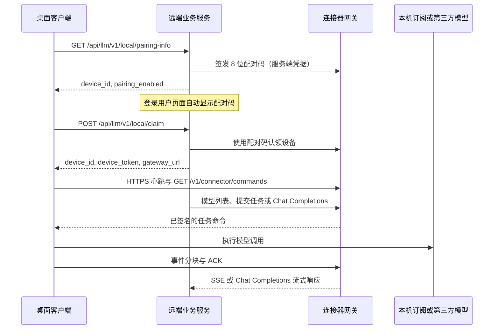

# 远端服务接入协议与服务端实现指南

本文以当前代码为准，说明远端业务服务如何与 LocalSubProxy 桌面客户端互通，以及在不使用项目自带 Go 参考网关时，需要实现哪些连接器协议。适用版本为 `connector.v1`。原始规划见 [详细设计方案](SaaS本地大模型连接器详细设计方案.html)，现有实现与命令行联调见 [实现与集成设计](实现与集成设计.md)。**原始规划中的 WSS、设备密钥证明、多租户注册等内容不等于当前客户端已实现的协议。**

## 1. 先确定服务端边界

当前系统有三方，不应把它们的地址或凭据混为一谈：

| 组件 | 职责 | 当前实现 |
| --- | --- | --- |
| 桌面客户端 | 本机管理模型方案、保存设备凭据、主动拉取任务并回传结果 | `desktop/` 与 `internal/connector/` |
| 远端业务服务 | 用户登录、设备归属校验、显示配对码、向网关提交模型请求、向页面转发结果 | 相邻项目 `sophorn-mock-server` 是单用户模拟实现 |
| 连接器网关 | 持有设备身份与任务状态，调度、长轮询、运行许可、事件 ACK、SSE | `internal/server/` 是单设备参考实现 |

推荐先部署现有 Go 网关，业务服务只实现第 2 节的配对接口和第 4 节的业务代理。这样客户端无需修改。若要用自己的网关替换 Go 网关，还必须实现第 3 节的 `connector.v1` 协议，不能只实现 OpenAI 兼容接口。



客户端与业务服务、网关的通信均由**客户端主动发起**。客户端不开放供业务服务回连的本机 HTTP 管理端口，UI 与 Go 内核之间使用进程内 FFI。第三方 API 密钥和 Codex 登录态只保存在本机，不应上传到业务服务。客户端当前只走 HTTP(S) 长轮询；网关虽保留 WebSocket 路由，但桌面客户端不会连接该路由。

## 2. 桌面客户端直接调用的业务服务接口（必需）

用户在应用中输入的是**业务服务地址**，例如 `https://service.example.com`，不是网关地址。地址只能是无路径、查询参数、片段和 URL 用户名的 origin；非回环地址必须使用 HTTPS。明文 HTTP 仅允许 `127.0.0.1` 或 `::1` 等回环 **IP**，`http://localhost` 不符合当前校验。客户端禁用 HTTP 重定向，使用系统默认 TLS 证书验证。业务服务必须从桌面客户端所在网络可达。

### 2.1 `GET /api/llm/v1/local/pairing-info`

客户端点击「连接」时调用。此时客户端没有业务服务登录 token，也没有设备 token，因此该接口不能要求客户端提供 Bearer 凭据。成功时必须返回 HTTP 200、JSON：

```json
{"device_id":"dev_local","pairing_enabled":true}
```

`device_id` 必须非空，`pairing_enabled` 必须为 `true`。客户端收到非 200、无效 JSON 或不满足上述字段时，会停止配对并显示错误。当前模拟服务在此请求中调用网关签发配对码，并在**已登录且有权操作该设备的用户页面**弹窗显示。配对码不得包含在此公开响应里；响应应设置 `Cache-Control: no-store`。

模拟服务的单设备实现使用固定 `ownerUserId`。正式多用户服务不能直接照搬：此接口没有用户身份或配对会话标识，单靠当前请求无法判定应向哪个用户展示验证码。必须先有安全的设备归属/配对会话机制；若需由桌面客户端传入会话标识，则须同时扩展客户端接口。不要把客户端自报的 `user_id` 当成可信归属。

### 2.2 `POST /api/llm/v1/local/claim`

用户把页面显示的 8 位数字填入桌面应用后调用。请求为 `Content-Type: application/json`：

```json
{"short_code":"01234567"}
```

成功必须返回 HTTP 200、JSON：

```json
{
  "device_id": "dev_local",
  "device_token": "至少 32 字符的设备凭据",
  "gateway_url": "https://gateway.example.com"
}
```

`device_id` 非空，`device_token` 长度至少 32，`gateway_url` 满足与业务服务地址相同的安全 URL 规则。客户端会把这些字段与业务服务地址写入本机身份文件，并立即启动出站连接；下次启动自动恢复。该接口在认领前也没有客户端 Bearer 凭据，服务端必须由**一次性验证码**完成验证。成功响应和错误响应不要缓存；不要将 `device_token` 写入页面、浏览器日志或服务端访问日志。

验证码展示属于业务服务自己的登录页面，不是客户端要调用的第三个配对接口。当前 mock 让页面每 1.5 秒调用已鉴权的 `GET /api/llm/v1/local/pending-pairing-code`，在确认 `ai` 权限和设备归属后返回 `{"pending":true,"short_code":"01234567","expires_at":"...","request_id":"..."}` 并弹窗；没有待处理请求时返回 `{"pending":false}`。正式服务可改用自己的推送机制，但验证码必须只对预定所有者可见。

当前模拟服务将请求转给网关 `POST /v1/connector/claim`，并把配置的网关 origin 原样作为 `gateway_url` 返回。**跨机器部署时，`gateway_url` 必须从桌面客户端可达。**如果业务服务与网关同在远端虚拟机，返回 `http://127.0.0.1:8080` 会让桌面客户端连接自己的本机 8080 端口，必然失败。可把网关放在可访问的 HTTPS 域名后，或通过同一 HTTPS 域名的 `/v1/*` 路由转发给网关。当前 mock 的 `LOCALSUBPROXY_URL` 同时用于服务端访问网关和返回给客户端，两条网络路径都必须可达；它没有独立的内部地址/外部地址配置。

### 2.3 `GET /health`：配对后的服务在线状态

配对成功后，桌面客户端约每 5 秒向业务服务 origin 请求 `GET /health`，与设备凭据的网关心跳共同判断界面上的「已连接」。此接口不应要求浏览器登录 token，不得生成新验证码或修改配对状态。返回 HTTP 200 和 JSON `{"status":"ok"}` 即可；当前 mock 的既有响应为 `{"data":{"apiBaseUrl":"..."}}`，客户端也接受。非 200、无效 JSON、超时或重定向会使业务服务显示为离线，即使网关仍在运行。客户端单次检查超时约 3 秒，服务恢复后会自动重新显示在线，无需重新配对。

### 2.4 业务服务与网关的配对调用

使用项目自带 Go 网关时，业务服务以**远端服务 Bearer token** 调用：

| 方法和路径 | 请求 | 成功响应 | 要点 |
| --- | --- | --- | --- |
| `POST /v1/connectors/{device_id}/pairing-code` | `{"user_id":"<已验证用户 ID>"}` | `{"device_id","short_code","expires_at"}` | 只在服务端调用；将验证码只展示给该用户 |
| `POST /v1/connector/claim` | `{"device_id":"...","short_code":"01234567"}` | `{"device_id","device_token","owner_id","status":"bound"}` | 此网关端点在认领前无 Bearer；业务服务不得向浏览器透传设备 token |

Go 网关要求用户 ID 为 1–128 个 ASCII 字母、数字、`_` 或 `-`。验证码有效期 5 分钟，错误最多 5 次；重新签发会使旧码失效，成功后不可重复使用。网关以持久化摘要保存验证码，并在 `-require-binding` 模式下拒绝未绑定设备的连接和任务。相同所有者可重新签发并认领，其他所有者会被拒绝。旧的 `POST /v1/connector/pairing` + `POST /v1/connectors/{id}/bind` 是命令行兼容路径，**不是当前桌面 UI 的配对流程**。

## 3. 自建网关需要实现的 `connector.v1` 协议

只接入现有 Go 网关的业务服务可以跳过本节。自建网关必须兼容以下接口的路径、鉴权、JSON 字段、状态语义及持久化顺序。客户端固定使用 `Authorization: Bearer <device_token>`；网关须将其与远端服务 token 分开，且两个 token 均至少 32 字符。设备被撤销或要求绑定但未完成时，设备接口应拒绝访问。

### 3.1 长轮询、心跳与任务分发

| 方法和路径 | 方向 | 必须实现的行为 |
| --- | --- | --- |
| `POST /v1/connector/heartbeat` | 客户端 → 网关 | 接收 `protocol:"connector.v1"`、`device_id`、`adapter`、`adapters`、`snapshot_version`；返回 `200 {"status":"ok"}`。校验协议和设备 ID；旧的快照版本不得覆盖新状态。 |
| `GET /v1/connector/commands` | 客户端 → 网关 | 保持请求最长约 25 秒；有任务时返回 200 的已签名 `task.dispatch` / `task.cancel`，无任务时返回 `200 {"type":"noop"}`。 |
| `POST /v1/connector/accepted` | 客户端 → 网关 | 接收 `task_id`、`attempt_id`、`fence_token`、`payload_hash`；验证该 attempt 与请求摘要，持久化接受状态；返回 `{"state":"ACCEPTED"}`（重试时也可为 `RUNNING`）。 |
| `POST /v1/connector/start` | 客户端 → 网关 | 同一 attempt 的启动许可；返回 `{"grant":"...","expires_at":"...","lease_until":"..."}`。必须在允许执行前持久化许可，重试不得创造第二次执行。 |
| `POST /v1/connector/lease` | 客户端 → 网关 | 运行中续期，接收 `task_id`、`attempt_id`、`fence_token`，返回新的 `lease_until`。 |
| `POST /v1/connector/events` | 客户端 → 网关 | 接收事件批次，事务性持久化后返回累计 `{"ack_seq":N,"state":"..."}`；重传同一事件须幂等，内容不同时拒绝。 |
| `GET /v1/connector/artifacts/{artifact_id}?task_id=...&attempt_id=...` | 客户端 → 网关 | 仅当附件已绑定此任务和 attempt 且处于允许执行的状态时返回文本、`X-Content-SHA256`，否则拒绝。 |

`heartbeat` 首次连接即发送，此后约每 25 秒发送；网关目前以 75 秒内的心跳判定设备在线。心跳的 `adapters` 列表包含本机允许的模型 ID、操作类型、健康状态、登录状态和空闲槽位。模型及凭据由本机配置，业务服务只能读取能力报告，不能指定本机 API 密钥或 Codex 可执行文件。对于 `openai_compatible`、`anthropic_compatible`，操作为 `chat.generate`；Codex 订阅适配器使用 `agent.run`。第三方供应商 API Key 不会出现在心跳中。

客户端 HTTP 请求超时为 35 秒，且不跟随重定向。长轮询反向代理超时须大于 25 秒，建议至少 40 秒；保持 JSON 响应不被登录页、重定向或 HTML 错误页替换。网络中断后客户端按约 1–30 秒指数退避重连，并补传本地 journal 中未确认事件。`GET /v1/connector/connect` 的 WSS 路由是旧兼容能力，当前桌面客户端不访问它。

### 3.2 命令签名与任务一致性

`task.dispatch` 命令至少包含：

```json
{
  "protocol": "connector.v1",
  "type": "task.dispatch",
  "device_id": "dev_local",
  "task_id": "task_<32位十六进制>",
  "attempt_id": "attempt_<32位十六进制>",
  "fence_token": 1,
  "expires_at": "2026-09-24T12:00:00Z",
  "request": {
    "target": {"device_id":"dev_local","adapter_id":"profile_1","model_id":"model-x"},
    "operation": "chat.generate",
    "input": {"messages":[{"role":"user","content":"你好"}]},
    "options": {"queue_ttl_seconds":300,"max_runtime_seconds":600}
  },
  "payload_hash": "<CreateTask 摘要>",
  "authorization": "<HMAC-SHA256 签名十六进制>"
}
```

客户端会逐一验证协议版本、设备 ID、命令有效期、`authorization`、`payload_hash`、本机适配器/模型/操作白名单，以及同一 attempt 的重复投递内容。`payload_hash` 是任务请求按 Go `protocol.CreateTask` JSON 编码后的 SHA-256；任务 API 中省略的超时值须先按网关默认值补齐。签名是以设备 token 为密钥、将 `authorization` 置空后按 Go `protocol.Command` JSON 编码所得字节的 HMAC-SHA256。**自建的非 Go 网关不能只对任意 JSON 字符串签名**：字段顺序、`omitempty`、时间格式与转义必须和当前 Go 编码一致。建议复用 [Go 协议结构与签名实现](../internal/protocol/protocol.go)及[参考网关签名实现](../internal/server/server.go)，并建立跨语言签名测试向量。

任务调度的关键顺序是：持久化任务和幂等键 → 分发命令 → 客户端本地 journal 写入 `ACCEPTED` → 网关确认接受 → 网关发放启动许可 → 客户端持久化启动意图 → 调用模型 → 持久化并补传事件。相同任务/attempt 不可重复执行；启动意图已写入而上游结果不明时必须进入 `UNKNOWN`/对账，不能自动重试模型调用。运行租约上限 120 秒，客户端在租约剩余不超过 90 秒时尝试续期；超过租约会停止执行，网关进入 `RECONCILING`。任务开始授权在参考网关中有效 30 秒。

### 3.3 事件与 ACK

批次格式如下；客户端每批最多发送 32 条，网关接受上限为 128 条、256 KiB，单条 `data` 上限 64 KiB：

```json
{
  "task_id":"task_...",
  "attempt_id":"attempt_...",
  "fence_token":1,
  "events":[
    {"seq":1,"kind":"task.started","at":"2026-09-24T12:00:00Z","data":{"run_id":"attempt_..."}},
    {"seq":2,"kind":"output.delta","at":"2026-09-24T12:00:01Z","data":{"channel":"answer","text":"你好"}},
    {"seq":3,"kind":"task.succeeded","at":"2026-09-24T12:00:02Z","data":{"completion_reason":"stop","usage":null,"usage_source":"unknown"}}
  ]
}
```

允许的 `kind` 为 `task.started`、`output.delta`、`task.succeeded`、`task.failed`、`task.cancelled`、`task.unknown`。`seq` 从 1 连续递增；同一 `attempt_id` 与 `fence_token` 的已确认事件可以原样重发，网关只能在**持久化成功后**提高 `ack_seq`。过期 attempt、序列缺口、不同内容的重复事件，以及时间戳晚于租约的输出或成功事件须拒绝。终态包括 `SUCCEEDED`、`FAILED`、`CANCELLED`、`EXPIRED`、`UNKNOWN`；`CANCEL_REQUESTED` 只是取消请求已登记，不保证最终一定取消。

## 4. 业务服务调用网关的接口

业务服务后端使用 `Authorization: Bearer <remote_service_token>`，并先验证自己的用户登录、`ai` 权限和设备所有者。此 token 绝不能发给浏览器。参考网关当前只有单设备静态 token，**不会替业务服务实施多租户 ACL**。

OpenAI 兼容协议和 Anthropic 兼容协议的供应商请求由**本机连接器直接发起**。远端业务服务无需代存供应商 API Key，也无需调用供应商的 `/v1/messages` 或 `/v1/chat/completions`；它调用下面的网关接口即可。

| 功能 | 参考网关接口 | 当前 mock 对外路径 `/api/llm/v1/local/*` |
| --- | --- | --- |
| 查询设备、适配器与健康状态 | `GET /v1/connectors` | `GET /connectors` |
| OpenAI 风格文本模型列表 | `GET /v1/models` | `GET /models` |
| OpenAI 风格文本对话 | `POST /v1/chat/completions` | `POST /chat/completions` |
| 创建任务 | `POST /v1/llm-tasks` | `POST /tasks` |
| 查询任务 | `GET /v1/llm-tasks/{id}` | `GET /tasks/{id}` |
| 订阅任务事件 | `GET /v1/llm-tasks/{id}/events` | `GET /tasks/{id}/events` |
| 请求取消 | `POST /v1/llm-tasks/{id}/cancel` | `POST /tasks/{id}/cancel` |
| 上传文本附件 | `POST /v1/task-artifacts` | `POST /artifacts` |
| 撤销设备 | `POST /v1/connectors/{device_id}/revoke` | `POST /connectors/{device_id}/revoke` |

### 4.1 文本 Chat Completions

`GET /v1/models` 返回 `{"object":"list","data":[{"id":"adapter_id/model_id","object":"model","owned_by":"adapter_id"}]}`。当前只列出在线、健康为 `ready` 且支持 `chat.generate` 的适配器；**Codex 的 `agent.run` 模型不会出现在此列表**。模型 ID 按第一个 `/` 分割，后半部分可以继续包含 `/`。

`POST /v1/chat/completions` 仅接受文本子集：

```json
{"model":"profile_1/model-x","messages":[{"role":"user","content":"你好"}],"stream":true}
```

`stream:false` 成功时返回 `chat.completion` JSON；`stream:true` 返回 `text/event-stream`，正文增量位于 `data: {"choices":[{"delta":{"content":"..."}}]}`，结束为 `data: [DONE]`。流中失败会发送 `event: error`，流结束仍发送 `[DONE]`；消费端不能把 HTTP 200 或 `[DONE]` 单独当作成功。模型调用取消、超时、网络断开与任务状态需按实际终态处理。当前不支持工具调用、图片、音频及完整 OpenAI 参数集。mock 必须原样逐块转发 SSE，设置 `Content-Type: text/event-stream`、`Cache-Control: no-cache`、`X-Accel-Buffering: no`，避免反向代理缓冲；浏览器断开时取消上游请求。

### 4.2 任务 API：Codex、取消、重放和附件

创建任务时 `Idempotency-Key` 必须为 8–128 字符。每次逻辑任务使用新键，网络重试使用原键；相同键不同请求返回 409，相同键相同请求返回原任务。成功返回 HTTP 202、含 `task_id` 和 `state` 的任务 JSON。`target` 必须同时指定设备、适配器和模型 ID。`operation` 只允许 `chat.generate` 或 `agent.run`，且须与适配器公布的操作一致。Codex 订阅适配器使用 `agent.run`：

```http
POST /v1/llm-tasks
Authorization: Bearer <remote_service_token>
Idempotency-Key: task-example-0001
Content-Type: application/json
```

```json
{
  "target":{"device_id":"dev_local","adapter_id":"codex-local","model_id":"gpt-6-sol"},
  "operation":"agent.run",
  "input":{"messages":[{"role":"user","content":"请用三句话总结。"}]},
  "options":{"queue_ttl_seconds":300,"max_runtime_seconds":600}
}
```

消息角色仅支持 `system`、`user`、`assistant`，最多 100 条；任务 JSON 内联部分最多 128 KiB。`queue_ttl_seconds` 与 `max_runtime_seconds` 默认分别为 300、600，允许范围均为 1–3600 秒。上传附件只支持非空、至多 1 MiB 的 UTF-8 `text/plain`，每任务最多引用 5 个 `artifact_id`，放在 `input.artifact_refs`。连接器仅以对应任务和 attempt 下载并核对 SHA-256。附件内容和正文都会经过业务服务与网关，不能把本机文件路径交给云端读取。

`GET /v1/llm-tasks/{id}/events` 是任务事件 SSE。每个输出事件带 `id: <attempt_id>:<seq>`、`event: <kind>`、`data: <Event JSON>`；断线重连使用 `Last-Event-ID`，网关会补发其后的事件，并每约 15 秒发送 keepalive 注释。终态另发 `event: state`。业务服务转发该请求时必须保留 `Last-Event-ID`、SSE 帧边界和流式刷新，按用户与设备归属逐次鉴权。页面按事件 ID 去重，避免重连后重复拼接文本。

## 5. 部署、安全与联调验收

1. **网络地址**：业务服务地址与 `gateway_url` 均从客户端可达；业务服务后端也能访问网关。不同机器上的 `127.0.0.1` 不是同一地址。非回环网络使用有效证书的 HTTPS，不能依赖自签名证书跳过校验或 HTTP 重定向。
2. **凭据隔离**：远端服务 token 只在业务服务后端和网关；设备 token 只在客户端和网关；模型 API Key 与 Codex 订阅登录态只在客户端。本机 UI 通过 FFI 管理内核，不需要管理 API 端口。
3. **用户权限**：所有业务查询、任务、SSE、附件与撤销接口都验证登录用户、`ai` 权限和设备归属。配对码只向预定所有者显示；公开的配对检查和认领端点须限流、禁缓存，并由网关限制有效期和尝试次数。
4. **持久化**：网关保存任务、幂等键、绑定、撤销、运行许可、租约、事件及 ACK；只有写入成功才回复成功。当前参考网关使用单文件快照，只适合单实例验证。多实例服务需要事务数据库和可靠事件通知，不能共享这一快照文件运行多实例。
5. **反向代理**：允许 25 秒的连接器长轮询与持续的 SSE；流式路径关闭响应缓冲，客户端断开时及时取消。不要把 API 错误改写成登录页或 302。

建议按以下顺序验收：

- 未配置网关时 `/pairing-info` 返回明确的 503；配置后桌面点击「连接」能让已登录用户页面自动显示验证码。
- 正确验证码只可使用一次；错误码、过期码、重复使用、跨用户认领均被拒绝。认领后客户端使用返回的 `gateway_url` 成功发送心跳，`GET /v1/connectors` 显示设备在线和方案列表。
- 第三方 API 方案出现在 `/v1/models`；`stream:false` 返回文本，`stream:true` 可逐块显示并以 `[DONE]` 结束。Codex 方案从任务 API 以 `agent.run` 执行，不假设它在 OpenAI 文本模型列表中。
- 重复提交同一 `Idempotency-Key` 不产生第二次模型调用；断开网关期间未确认事件恢复后补传且不重复显示。任务取消先进入请求状态，再依据真实执行结果进入终态。
- 网关重启后绑定、撤销、任务和 ACK 仍存在；客户端重启后可用保存的身份恢复连接；设备撤销后不允许旧 token 再连接。

## 6. 当前实现与正式服务之间的差距

当前 Go 网关和 mock 是**单租户、单设备的参考实现**，使用长效远端服务 token，并在配对成功后向客户端发放设备 token。尚未实现多租户设备注册、设备密钥证明、短期凭据与轮换、数据库 outbox、多实例调度和完整运行时恢复。若正式服务要支持多用户同时配对，必须先扩展第 2.1 节的用户关联机制；若替换网关，还要完整实现第 3 节的签名、状态机和持久化，不应只复制 URL 路由。客户端本地可配置 OpenAI Codex 订阅、OpenAI 兼容协议和 Anthropic 兼容协议；业务服务与网关会经过任务输入和输出，但不直接持有这些供应商凭据。

关键代码依据：[桌面配对请求](../internal/connector/remote_pairing.go)、[客户端长轮询和事件补传](../internal/connector/connector.go)、[协议结构](../internal/protocol/protocol.go)、[参考网关路由与状态机](../internal/server/server.go)、[配对和认领](../internal/server/enrollment.go)、[OpenAI 文本接口](../internal/server/openai.go)。mock 的业务路由位于相邻项目 `sophorn-mock-server/src/local-connector.js`。
