# Avora 使用教程

Avora 让你授权的 SaaS 调用你自己的模型（Codex 订阅、Ollama 本地模型、OpenAI / Anthropic 兼容接口的 API Key），密钥始终留在本机。本教程按实际使用顺序介绍桌面端的全部操作。

> 截图来自当前版本的界面，示例数据为虚构。

**目录**

1. [安装](#1-安装)
2. [首次启动](#2-首次启动)
3. [添加方案](#3-添加方案)
4. [管理方案](#4-管理方案)
5. [连接 SaaS（配对）](#5-连接-saas配对)
6. [查看连接与状态](#6-查看连接与状态)
7. [设置每个连接可用的模型](#7-设置每个连接可用的模型)
8. [断开与撤销连接](#8-断开与撤销连接)
9. [用量统计](#9-用量统计)
10. [常见问题](#10-常见问题)
11. [深色模式](#11-深色模式)
12. [无界面模式](#12-无界面模式)

## 1. 安装

从 [Releases](https://github.com/tyro668/avora/releases) 下载安装包：macOS 用 `.dmg`，Windows 用 `setup.exe`。安装包暂未签名，首次打开被系统拦截时，按 [release.md 的说明](release.md#未签名构建的注意事项) 处理。

## 2. 首次启动

打开应用后，左侧是「配置方案」列表，右侧是「方案详情」，底部状态栏显示连接状态、本机设备名、任务数和「用量统计」入口。还没有方案时，列表中间提示「添加第一个模型方案」。

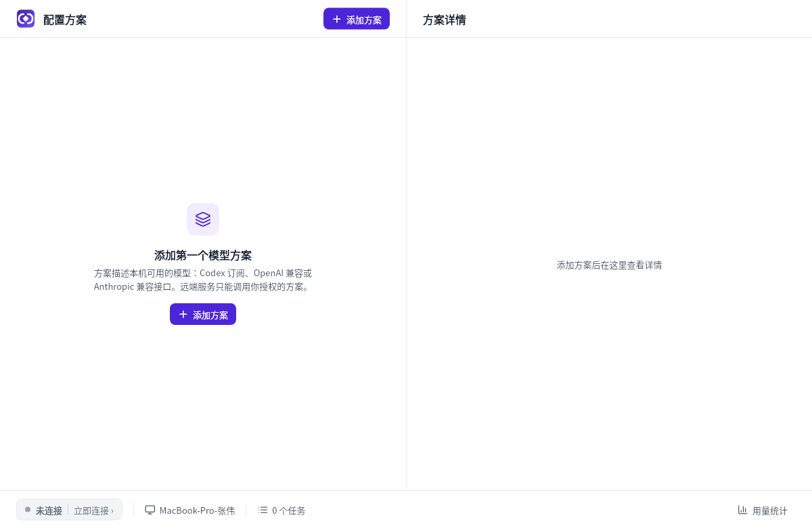

关闭窗口只会隐藏界面，内核继续在后台运行。从系统托盘（macOS 菜单栏）的「配置」重新打开窗口，「退出」才会真正停止。

## 3. 添加方案

**方案**是一个可供 SaaS 调用的模型：服务类型 + 连接信息 + 模型。点「添加方案」，右侧出现「编辑方案」表单，列表里多出一行带「草稿」标记的「未命名方案」。

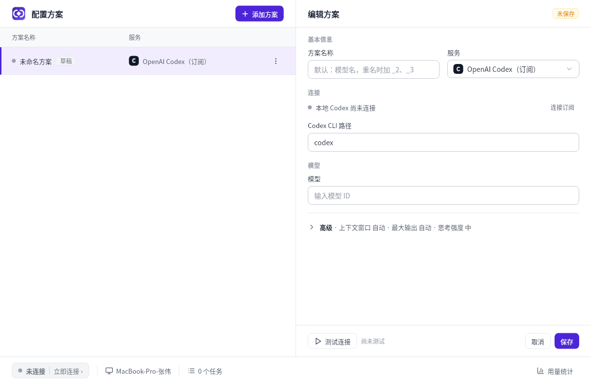

在「服务」下拉框里选择类型：

| 服务 | 需要填写 | 说明 |
|---|---|---|
| OpenAI Codex（订阅） | Codex CLI 路径（默认 `codex`）、模型 | 使用本机已安装的官方 Codex CLI。未登录时点「连接订阅」，在浏览器完成登录后自动检测；也可以点「检查登录」。只支持纯文本 |
| OpenAI 兼容协议 | API 地址、API 密钥、模型 | 适用于 OpenAI 以及 DeepSeek、通义千问等兼容接口 |
| Anthropic 兼容协议 | API 地址、API 密钥、模型 | 适用于 Anthropic 及其兼容接口 |
| Ollama 协议（本地模型） | API 地址、模型 | 默认地址 `http://127.0.0.1:11434`，无需 API 密钥，使用本机 Ollama 已下载的模型 |

「方案名称」可以留空，默认使用模型名，重名时自动加 `_2`、`_3`。

### 示例：添加一个 OpenAI 兼容方案

1. 「服务」选择「OpenAI 兼容协议」。
2. 填写「API 地址」（例如 `https://api.deepseek.com/v1`）和「API 密钥」。
3. 点底部的「测试连接」。通过后，表单顶部显示「连接测试通过」和发现的模型，「模型」下拉框会列出这些模型（列表来自 `/v1/models`，最后一项可以输入自定义模型 ID）。
4. 选择模型，按需展开「高级」设置上下文窗口、最大输出和思考强度，然后点「保存」。表单右上角的「未保存」标记会消失。

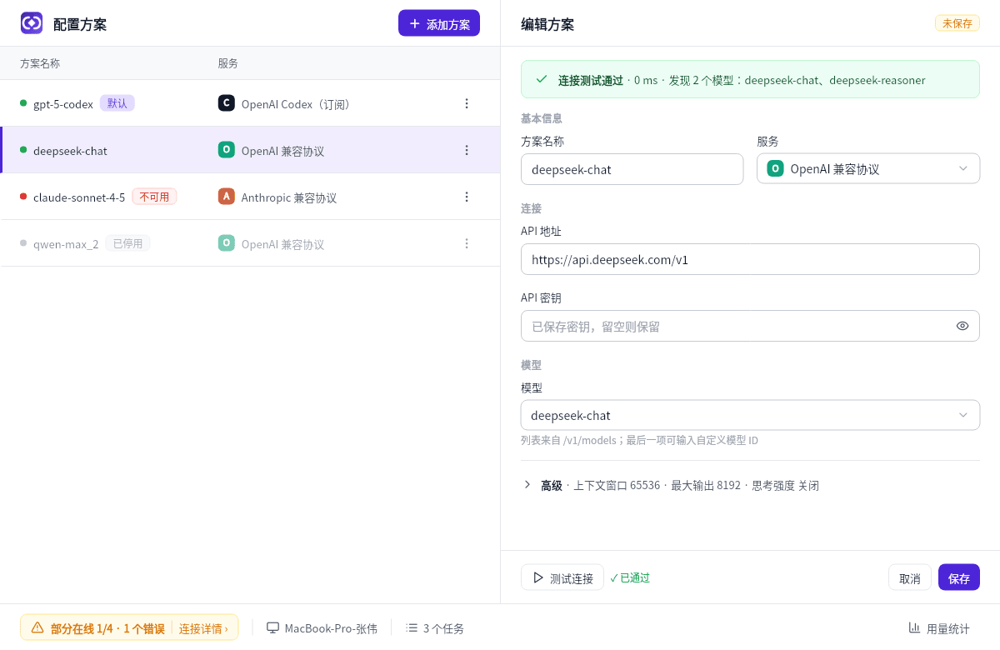

如果服务能正常推理但没有 `/models` 接口，勾选「跳过模型列表探测」后再保存。

### 示例：添加一个 Ollama 本地模型方案

1. 确认本机 Ollama 服务已启动，并已下载要使用的模型。
2. 点「添加方案」，「服务」选择「Ollama 协议（本地模型）」。
3. 「API 地址」默认填入 `http://127.0.0.1:11434`。如使用其他本机端口，可修改此地址；只填写根地址，不要添加 `/api` 或 `/v1`，无需填写 API 密钥。
4. 点「获取模型」，从 Ollama 返回的已下载模型中选择；也可以直接输入完整模型 ID（例如 `qwen3:8b`，须与本机模型名称和标签一致）。
5. 点「测试连接」，通过后点「保存」，再在远端服务的模型授权中勾选此方案。

## 4. 管理方案

保存后的方案出现在列表中。每行的圆点和标记表示状态：绿点为可用，红点加「不可用」表示最近一次检查失败，灰色「已停用」表示该方案当前不提供服务。点选一行，右侧显示它的详情，点「编辑」可以修改。

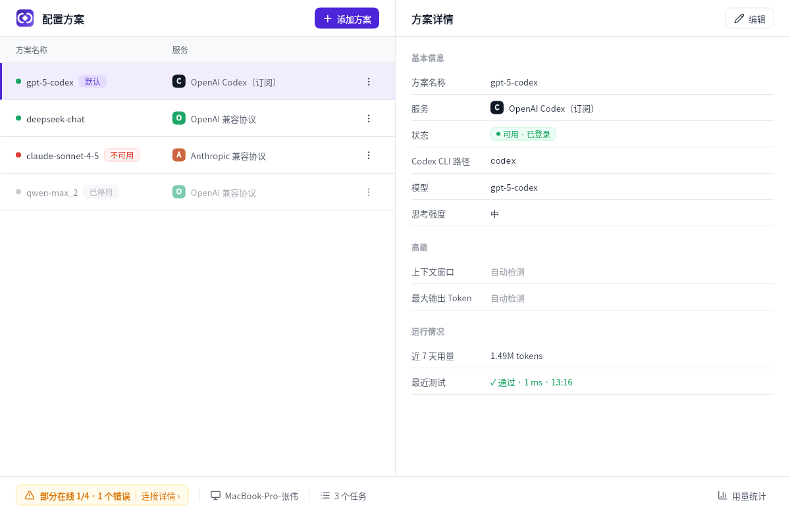

点每行右侧的 ⋮ 打开菜单：

- **重命名**：只改显示名称。
- **设为默认方案**：列表中带「默认」标记的方案。
- **测试连接**：重新检查，结果显示在详情的「最近测试」中。
- **删除方案**：需要确认。

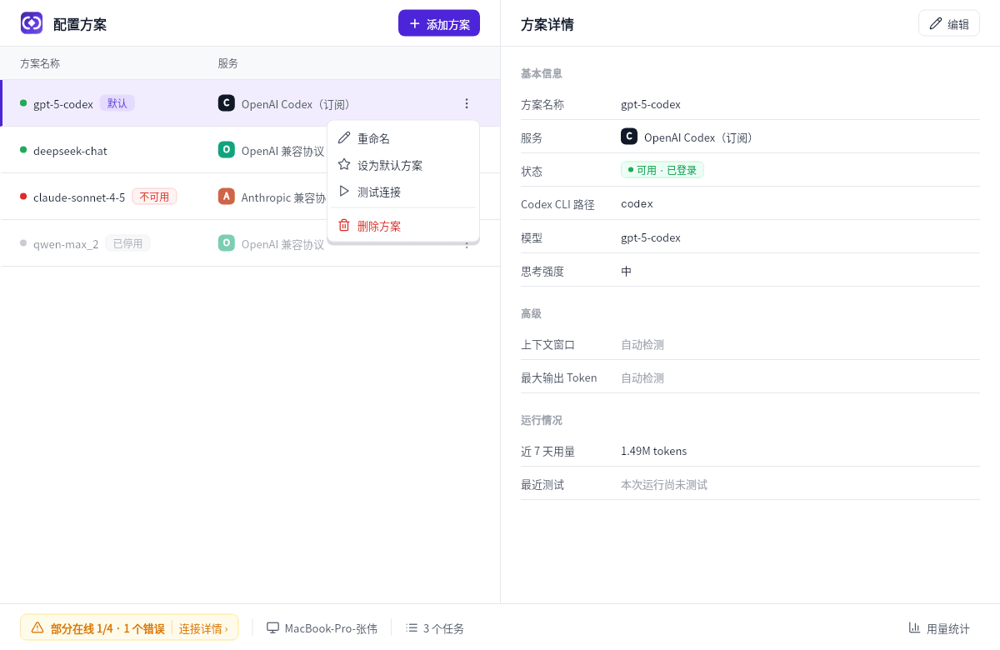

删除前，确认框会列出哪些已授权的远端服务将无法再调用这个模型。

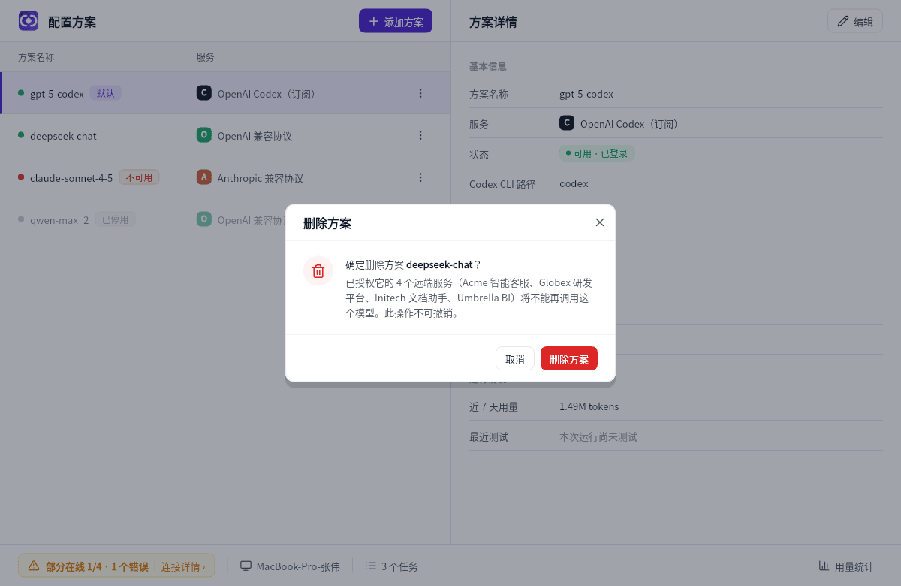

## 5. 连接 SaaS（配对）

点底部状态栏的「立即连接 ›」（已有连接时为「连接详情 ›」，再点「添加连接」），打开「远端服务连接」。

**第 1 步：输入地址。** 粘贴 SaaS 提供的服务地址（`https://…`）或配对链接（`lmbp://pair?…`），点「连接」。本机只会主动连出，不需要开放端口。

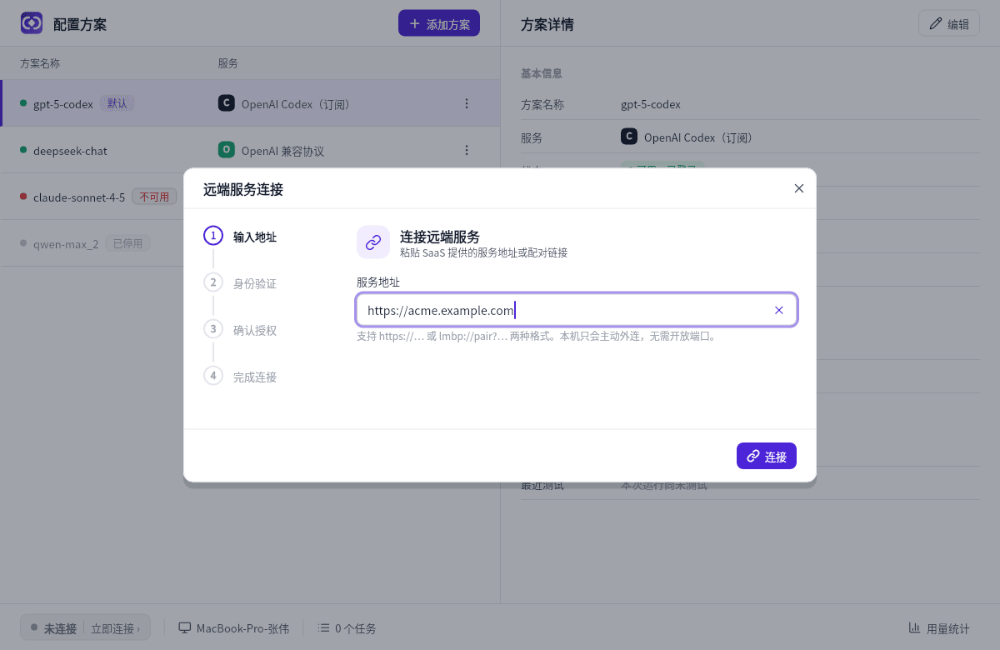

**第 2 步：身份验证。** 确认 SaaS 的名称、网关、隐私政策和请求的权限；显示「签名已校验」表示这些信息经过网关签名验证。在「授权给它的模型」里勾选允许它使用的方案，然后点「同意并配对」；不认识的服务请点「拒绝」。

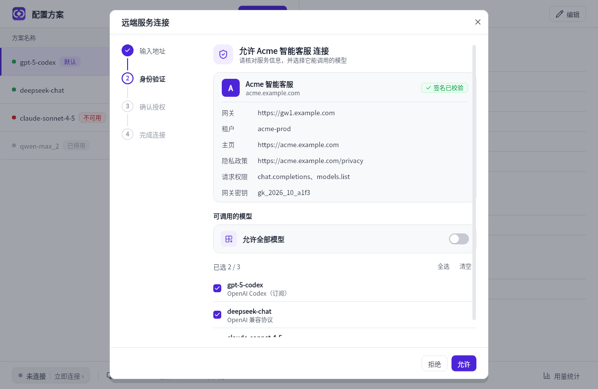

**第 3 步：输入配对码。** 把显示的配对码（如 `K7QF-3H9X`）填到 SaaS 页面上，或点「在浏览器中打开确认页」。配对码有有效期，倒计时显示在下方。SaaS 确认后进入「完成连接」，连接即可使用。

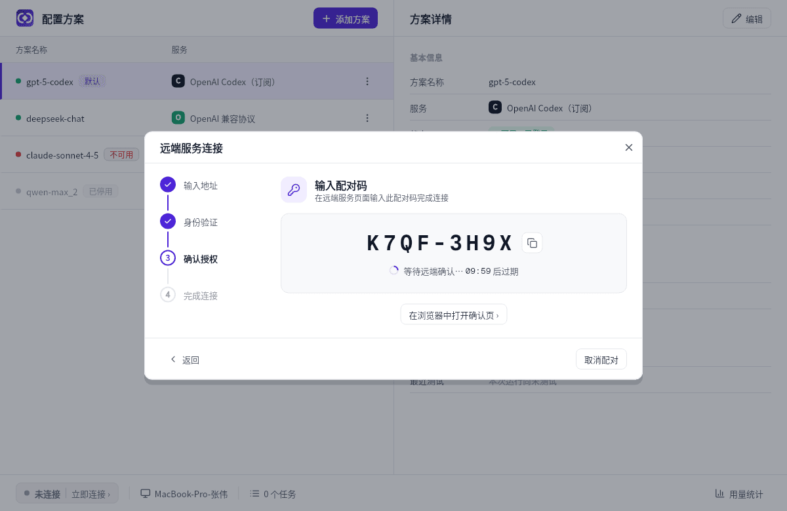

## 6. 查看连接与状态

点状态栏左侧的状态标签打开「远端服务连接」，这里列出所有已配对的 SaaS，每个连接显示允许的模型和当前任务数。

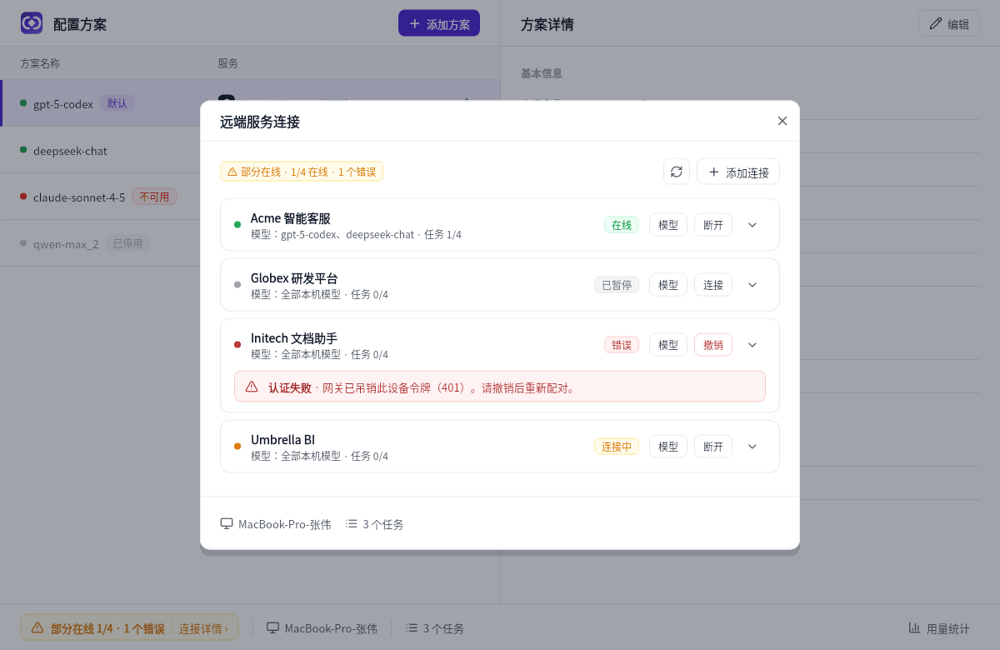

单个连接的状态：

| 标记 | 含义 |
|---|---|
| 在线（绿） | 与网关的会话已建立，可以处理请求 |
| 连接中（橙） | 正在建立或断线后自动重连，无需操作 |
| 已暂停（灰） | 你点了「断开」，配对保留，点「连接」恢复 |
| 错误（红） | 无法继续，例如「认证失败」（网关已吊销设备令牌），请撤销后重新配对 |

状态栏的颜色汇总所有连接：绿色「全部在线」、橙色「部分在线」或「连接中」、红色「连接异常」、灰色「未连接」。出错的连接数会附在后面，例如「部分在线 1/4 · 1 个错误」。

## 7. 设置每个连接可用的模型

在连接列表中点某个连接的「模型」，打开「可用模型」，勾选这个 SaaS 可以调用的方案（「全选」/「清空」），点「保存」。不可用或已停用的方案也可以勾选，授权会保留，方案恢复后自动生效。

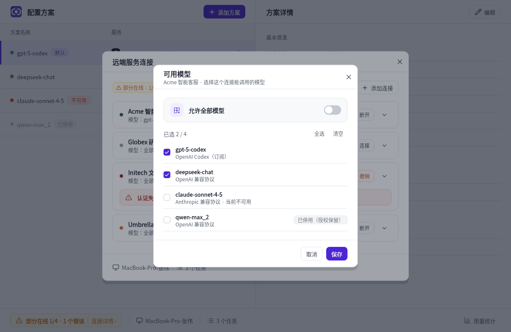

## 8. 断开与撤销连接

- **断开**：暂停这个连接，配对和设置都保留，之后点「连接」即可恢复。
- **撤销**：彻底移除。点连接右侧的 ⌄ 展开详情后点「撤销」（出错的连接直接显示「撤销」按钮），确认后会断开这个 SaaS，并删除本机为它保存的设备私钥，其他连接不受影响。再次使用需要重新配对。

## 9. 用量统计

点状态栏右侧的「用量统计」，查看近 7 天本机各方案的输入、输出和总 Token 数。这里只统计 Token 数，不记录对话内容。

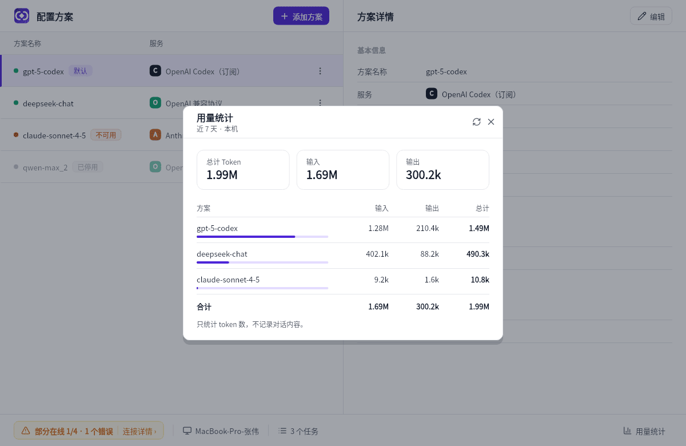

## 10. 常见问题

**无法启动本机服务。** 启动失败时显示「无法启动本机服务」和原因。可以点「复制」把错误详情发给支持人员，点「打开数据目录」检查文件，处理后点「重试」。常见原因：

- 「本机数据库被占用」：已有一个 Avora 在运行。从托盘「退出」另一个实例后重试。
- 「没有访问本机数据目录的权限」：检查数据目录的读写权限。
- 「磁盘空间不足」：清理磁盘后重试。

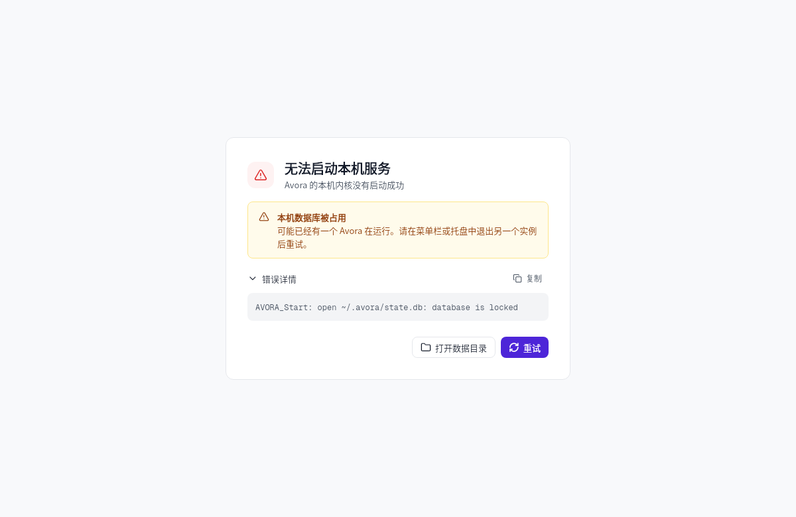

**数据目录正被另一个 Avora 使用。** 桌面应用和无界面模式（`avora serve`）不能同时使用同一个数据目录。停止 `serve`（或另一个桌面实例）后点「重试」。

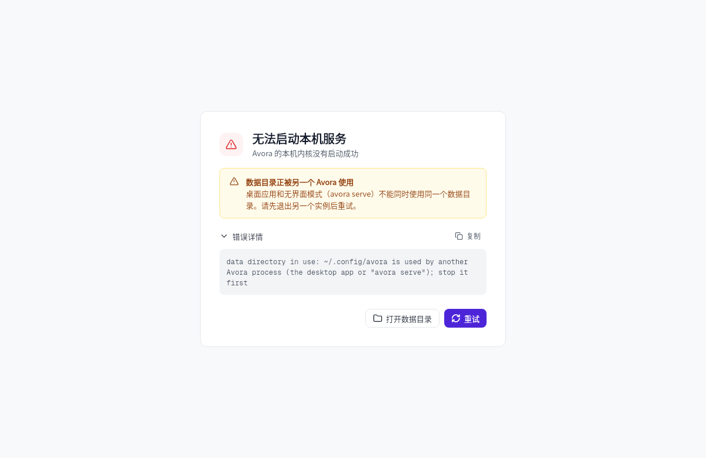

**窗口顶部出现红色提示条。** 例如「有 1 个已撤销连接的本机私钥未能删除，将在下次启动时重试。」通常是文件暂时被占用，应用会自动重试；点「查看详情」看具体文件，点 × 关闭提示。

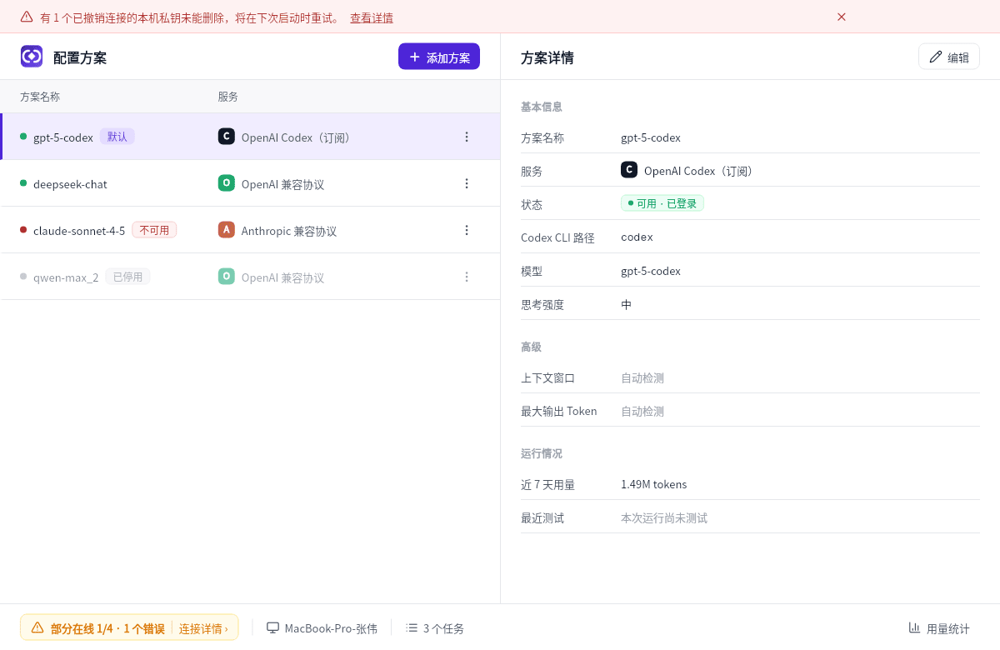

**方案显示「不可用」。** 打开方案点「编辑」，再点「测试连接」查看原因（地址、密钥或模型 ID 错误；Codex 方案可能需要重新登录）。

## 11. 深色模式

界面跟随系统外观自动切换浅色或深色，无需单独设置。

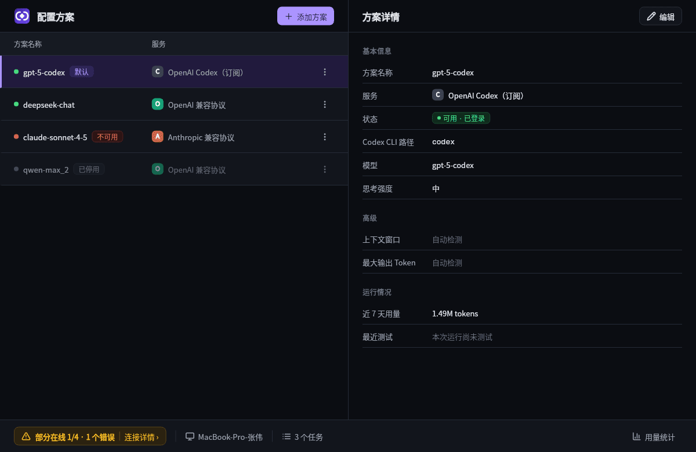

## 12. 无界面模式

在服务器或没有桌面环境的机器上，可以用命令行 `avora serve` 运行同一个内核，并用 `pair`、`scheme`、`status` 等命令完成上面的所有操作，也可以作为 systemd / launchd / Windows 计划任务运行。详见 [headless.md](headless.md)。
