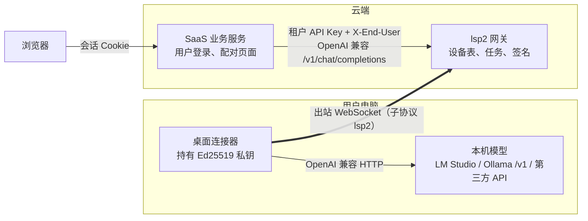

# LocalSubProxy 协议 v2（lsp2）：一页看懂

> 状态：**参考实现位于 `mock/`**（`mock/v2proto`、`mock/gateway`、`mock/connector`、`mock/saas`）。现有桌面客户端与 `internal/server` 仍使用 `connector.v1`，尚未迁移（见文末“迁移”）。标注 **[规范]** 的内容只写在文档里，还没有代码实现。

## 1. 三个角色，两条连接



- **浏览器永远不连本机**，所以不涉及 NAT、CORS、混合内容。
- **连接器只做出站连接**：先用 HTTPS 配对，之后保持一条 WebSocket。
- **SaaS 只需要会说 OpenAI 协议**：调用 `/v1/models`、`/v1/chat/completions`，再加一个“批准设备”接口。

## 2. 只有三步

| 步骤 | 谁 → 谁 | 接口 | 一句话说明 |
|---|---|---|---|
| ① 配对 | 连接器 → 网关 | `POST /v2/device/authorize`、`POST /v2/token` | 走 OAuth 2.0 设备授权（RFC 8628）：连接器显示配对码，用户在已登录的 SaaS 页面输入 |
| ② 连接 | 连接器 → 网关 | `GET /v2/connect`（WebSocket，子协议 `lsp2`） | 用短期令牌连上来，发 `hello`，收到 `welcome` |
| ③ 跑任务 | 网关 ⇄ 连接器 | `task.run` → `task.delta`… → `task.done`/`task.error` | 网关签名后下发，本机流式回传 |

## 3. 消息一览（共 10 种）

所有 WebSocket 帧都使用同一个信封：

```json
{"v":2, "type":"task.delta", "id":"可选，用于请求/响应关联", "task_id":"task_…", "seq":3, "data":{…}, "sig":"只有 task.run 带"}
```

| type | 方向 | data | 说明 |
|---|---|---|---|
| `hello` | 连接器→网关 | `device_id, client, models[], max_concurrency, ts, proof` | 声明能力，并证明持有设备私钥 |
| `welcome` | 网关→连接器 | `session_id, heartbeat_seconds, max_frame_bytes, token_expires_at` | 握手成功 |
| `task.run` | 网关→连接器 | `device_id, model, messages[], max_tokens?, temperature?, exp, nonce` | **带网关 Ed25519 签名** |
| `task.delta` | 连接器→网关 | `text` | 流式片段；`seq` 从 1 开始连续递增 |
| `task.done` | 连接器→网关 | `finish_reason, usage?` | 成功结束（终态） |
| `task.error` | 连接器→网关 | `code, message, retryable` | 失败或已取消（终态） |
| `task.cancel` | 网关→连接器 | `reason` | 请求取消；连接器以 `task.error{code:"CANCELLED"}` 收尾 |
| `ping` / `pong` | 双向 | — | 应用层心跳；网关另外每 20 秒发一次 WebSocket 原生 ping |
| `error` | 网关→连接器 | `code, message` | 连接级错误，比如握手失败、未知消息类型 |

**只有三条规则：**
1. 每个任务先有若干 `task.delta`，最后**恰好一个** `task.done` 或 `task.error`。
2. `seq` 必须连续（1, 2, 3…）。出现缺口时网关判定任务失败，并发出 `task.cancel`。
3. 连接器只执行同时满足以下条件的 `task.run`：签名正确、`device_id` 是自己、没过期、`nonce` 没见过、模型在本机白名单里、没超过并发上限。

## 4. 安全模型

| 问题 | v2 的做法 |
|---|---|
| 设备凭据 | 连接器在本机生成 **Ed25519 密钥对**，私钥不离开本机；网关只保存公钥 |
| 访问令牌 | 网关签发 **15 分钟有效的 EdDSA JWT**，其中 `cnf.jkt` 是设备公钥指纹，令牌与密钥绑定。续期时，连接器用私钥签一个 60 秒有效的断言来换新令牌（`grant_type=urn:ietf:params:oauth:grant-type:jwt-bearer`），用 `jti` 防重放 |
| 持钥证明 | `hello.proof = Ed25519("lsp2.hello\n<device_id>\n<token jti>\n<ts>")`，`ts` 允许 ±60 秒误差。只偷到令牌、没有私钥的人连不上 |
| 命令完整性 | `task.run.sig = Ed25519_gateway("lsp2.task.run\n<task_id>\n" + data 原始字节)`。签名覆盖的是**实际传输的字节**，与编程语言和 JSON 编码细节无关。网关公钥在配对时就固定在连接器里 |
| 多租户 | 每台设备归属于 `(tenant, owner)`。SaaS 调用网关时带**租户 API Key**（网关只存它的 SHA-256），并用 `X-End-User` 指明当前用户；网关只会路由到这个用户自己的设备 |
| 配对码泄露 | 配对码只显示在设备上，由用户在**已登录**的页面输入，没有任何匿名接口会返回配对码。配对码 10 分钟过期、只能用一次；每个租户每分钟最多允许 10 次输错 |
| 吊销 | `POST /v2/tenant/devices/{id}/revoke` 会立即关闭该设备的会话，之后的续期请求也会被拒绝 |

## 5. 完整示例

### 5.1 配对（RFC 8628）

```http
GET https://saas.example.com/.well-known/lsp-connector
→ {"gateway_url":"https://gw.example.com","tenant":"acme","link_url":"https://saas.example.com/link","protocol":"lsp2"}

POST /v2/device/authorize
{"tenant":"acme","public_key":"<base64url 32 字节>","device_name":"Alice-MacBook"}
→ {"device_code":"dc_…","user_code":"BCDF-GHJK","expires_in":600,"interval":2}
```

连接器显示 `BCDF-GHJK`。用户登录 SaaS，打开 `/link` 输入这个码，SaaS 后端随即调用：

```http
POST /v2/tenant/device-approvals
Authorization: Bearer <租户 API Key>
X-End-User: alice
{"user_code":"BCDF-GHJK"}
→ {"status":"approved","device_id":"dev_570c…","device_name":"Alice-MacBook"}
```

与此同时，连接器按 `interval` 间隔轮询：

```http
POST /v2/token
{"grant_type":"urn:ietf:params:oauth:grant-type:device_code","device_code":"dc_…","proof":"<Ed25519('lsp2.token\n'+device_code)>"}
→ 400 {"error":"authorization_pending"}   // 也可能是 slow_down（轮询间隔 +5 秒）、access_denied、expired_token
→ 200 {"access_token":"eyJ…","token_type":"Bearer","expires_in":900,"device_id":"dev_570c…",
       "gateway_key":{"kid":"…","alg":"EdDSA","x":"<网关公钥>"}}
```

### 5.2 连接与握手

```
GET /v2/connect   Upgrade: websocket   Sec-WebSocket-Protocol: lsp2   Authorization: Bearer eyJ…
→ {"v":2,"type":"hello","id":"h1","data":{"device_id":"dev_570c…","client":"lspmock-connector/0.1",
     "models":["qwen3-8b"],"max_concurrency":2,"ts":1791886877,"proof":"…"}}
← {"v":2,"type":"welcome","id":"h1","data":{"session_id":"sess_…","heartbeat_seconds":20,"max_frame_bytes":262144,"token_expires_at":1791887777}}
```

### 5.3 跑一个流式任务

SaaS 发起 `POST /v1/chat/completions {"model":"qwen3-8b","stream":true,"messages":[…]}` 后，网关和连接器之间的消息如下：

```
← {"v":2,"type":"task.run","task_id":"task_87c9…","data":{"device_id":"dev_570c…","model":"qwen3-8b",
     "messages":[{"role":"user","content":"帮我写一句问候"}],"exp":1791886940,"nonce":"n_…"},"sig":"…"}
→ {"v":2,"type":"task.delta","task_id":"task_87c9…","seq":1,"data":{"text":"你"}}
→ {"v":2,"type":"task.delta","task_id":"task_87c9…","seq":2,"data":{"text":"好"}}
→ {"v":2,"type":"task.done","task_id":"task_87c9…","seq":32,"data":{"finish_reason":"stop","usage":{"prompt_tokens":7,"completion_tokens":31}}}
```

SaaS 收到的是标准 OpenAI 格式的 SSE：

```
data: {"id":"chatcmpl-task_87c9…","object":"chat.completion.chunk","choices":[{"index":0,"delta":{"role":"assistant","content":""},"finish_reason":null}]}
data: {"id":"chatcmpl-task_87c9…","object":"chat.completion.chunk","choices":[{"index":0,"delta":{"content":"你"},"finish_reason":null}]}
…
data: {"id":"chatcmpl-task_87c9…","object":"chat.completion.chunk","choices":[{"index":0,"delta":{},"finish_reason":"stop"}],"usage":{"prompt_tokens":7,"completion_tokens":31}}
data: [DONE]
```

### 5.4 取消

用户关闭浏览器页面后，SaaS 断开它到网关的请求，网关随即：

```
← {"v":2,"type":"task.cancel","task_id":"task_12b3…","data":{"reason":"client_disconnected"}}
→ {"v":2,"type":"task.error","task_id":"task_12b3…","seq":11,"data":{"code":"CANCELLED","message":"cancelled","retryable":false}}
```

任务状态记为 `CANCELLED`。

### 5.5 出错

本机模型返回 HTTP 500 时：

```
→ {"v":2,"type":"task.error","task_id":"task_…","seq":1,"data":{"code":"UPSTREAM_ERROR","message":"local model returned HTTP 500","retryable":false}}
```

SaaS 侧 SSE 的最后一帧是 `data: {"error":{"code":"UPSTREAM_ERROR","message":"…","type":"lsp2_error"}}`，**出错之后不会再发 `[DONE]`**。因此收到 `[DONE]` 就一定代表成功。如果请求在开始流式输出之前就失败了，则返回普通的 HTTP 错误，body 采用 OpenAI 风格：`{"error":{"message","type":"lsp2_error","code"}}`。

## 6. 错误码

| code | HTTP | 可重试 | 含义 |
|---|---|---|---|
| `UNAUTHENTICATED` | 401 | 否 | 租户 Key、令牌或持钥证明无效 |
| `FORBIDDEN` | 403/404 | 否 | 设备不属于你、已被吊销，或被本机策略拒绝 |
| `BAD_REQUEST` | 400 | 否 | 参数错误，或配对码无效、已过期 |
| `MODEL_NOT_FOUND` | 404 | 否 | 你名下的设备上都没有这个模型 |
| `DEVICE_OFFLINE` | 503 | 是 | 设备不在线，或任务进行中设备断开 |
| `DEVICE_BUSY` | 429 | 是 | 设备已达到 `max_concurrency` 上限（响应带 `Retry-After`） |
| `UPSTREAM_ERROR` | 502 | 视情况 | 本机模型出错或连不上 |
| `TIMEOUT` | 504 | 是 | 任务超时（默认 10 分钟） |
| `CANCELLED` | — | 否 | 任务已取消 |
| `BAD_SIGNATURE` | — | 否 | 连接器拒绝了签名不对的 `task.run` |
| `VERSION_UNSUPPORTED` | 400 | 否 | 缺少 `lsp2` 子协议，或 `v` 版本不支持 |
| `INTERNAL` | 500 | 是 | 网关内部错误，或 `seq` 出现缺口 |

OAuth 接口（`/v2/token`）使用 RFC 8628 / RFC 6749 的标准错误：`authorization_pending`、`slow_down`、`access_denied`、`expired_token`、`invalid_grant`、`unsupported_grant_type`。

## 7. 模型命名与路由

- `GET /v1/models` 只返回**当前用户名下在线设备**上的模型，id 格式为 `dev_xxx/<model>`。
- `model` 字段可以写全名 `dev_xxx/qwen3-8b`，也可以只写 `qwen3-8b`，此时选用第一台在线且有这个模型的设备。
- 目前支持 `model, messages, stream, max_tokens, temperature` 这几个字段，其他 OpenAI 字段**会被忽略，不会报错**。

## 8. 存储

- 存储层是 `store.Store` 接口，参考实现为 SQLite（`modernc.org/sqlite`，纯 Go，开启 WAL）。表有 `tenants / device_auths / devices / tasks / events`。
- 设置 `LSP_DATA_KEY`（32 字节，hex 编码）后，提示词和输出会用 AES-256-GCM 加密后再落盘（前缀 `enc1:`）。没有配置密钥时，读取加密行会直接报错，不会悄悄返回密文。
- 保留期通过 `-retention 168h` 设置（默认 7 天），网关每小时清理一次已结束的任务及其事件，以及过期的配对记录。
- 要换成 Postgres，实现同一个接口即可（SQL 基本可以复用，把 `BLOB` 换成 `BYTEA`）。

## 9. [规范] 尚未实现

- **断线续传**：现在设备一断开，任务就失败（`DEVICE_OFFLINE`，可重试）。规划是连接器在 `hello` 里带上 `resume:[{task_id, last_seq}]`，网关补齐缺失部分后继续推送。
- **流控**：规划是由 `welcome` 或 `task.run` 授予 `credits`，再通过 `task.ack{task_id, ack_seq, credits}` 补充。目前依靠 WebSocket 自身的背压，加上网关为每个任务预留的 1024 帧缓冲，溢出时直接断开会话。
- **会话内令牌轮换**（`session.token`）：目前令牌只在建立连接时校验，吊销靠主动关闭会话来生效。
- **工具调用、多模态、Responses API**：目前消息内容只支持字符串。
- **多实例网关**：会话保存在单个进程的内存里，多实例部署需要按 `device_id` 做粘性路由，或者引入消息总线。
- **端到端加密**（SaaS 用设备公钥加密 messages，网关看不到明文）：未实现。

## 10. 从 v1 迁移

v1（`connector.v1`，即 `internal/server` 加现有桌面端）**原样保留，没有改动**，旧客户端可以继续用。迁移步骤：

1. 部署 v2 网关。它可以和 v1 网关并行运行，路径不冲突（v2 都在 `/v2/*` 下）。
2. SaaS 新增 `/.well-known/lsp-connector` 和 `/link` 页面，配对改为调用 `/v2/tenant/device-approvals`。业务调用仍然是 `/v1/chat/completions`，但鉴权从全局 remote token 改为**租户 Key + `X-End-User`**。
3. 桌面端内核改用 `mock/connector` 里的逻辑（配对、WebSocket、验签）。v1 的设备 token 无法迁移，**每台设备需要重新配对一次**。
4. 本机的模型配置（`adapters.enc`）与 v2 无关，可以保留。
